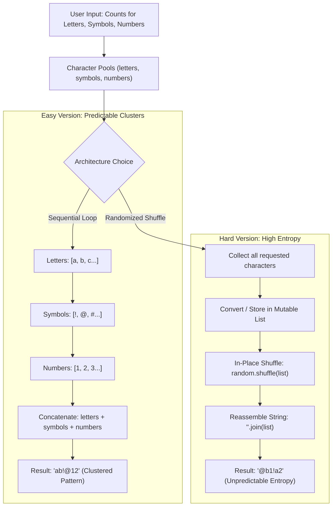

# Python Course Notes: Day 5 — Loops in Python & the `range()` Function

A comprehensive, structured reference guide covering iteration mechanics, lexical loop scope, algorithm reconstruction (`sum`, `max`, `min`), sequence generation with `range()`, the classic FizzBuzz interview challenge, and the **PyPassword Generator** capstone (Easy vs. Hard entropy architectures, mutability, in-place shuffling, and sequence reassembly).

---

## Table of Contents
1. [Core Concepts of Iteration](#1-core-concepts-of-iteration)
   - [What is a `for` Loop?](#what-is-a-for-loop)
   - [Syntax & Mechanics](#syntax--mechanics)
   - [Temporary vs. Persistent Variables](#temporary-vs-persistent-variables)
2. [Indentation & Loop Scope](#2-indentation--loop-scope)
   - [Inside vs. Outside the Loop Body](#inside-vs-outside-the-loop-body)
   - [Common Indentation Pitfalls](#common-indentation-pitfalls)
3. [Algorithmic Patterns: Accumulators & Reductions](#3-algorithmic-patterns-accumulators--reductions)
   - [The Accumulator Pattern (Recreating `sum()`)](#the-accumulator-pattern-recreating-sum)
   - [Critical Best Practice: Avoiding Built-in Variable Shadowing](#critical-best-practice-avoiding-built-in-variable-shadowing)
4. [Finding Extreme Values: `max()` & `min()`](#4-finding-extreme-values-max--min)
   - [Recreating `max()` from Scratch](#recreating-max-from-scratch)
   - [Edge Case: Why Initializing to `0` Can Fail](#edge-case-why-initializing-to-0-can-fail)
   - [Extending the Algorithm: Recreating `min()`](#extending-the-algorithm-recreating-min)
5. [The `for` Loop with `range()`](#5-the-for-loop-with-range)
   - [Understanding `range(start, stop, step)`](#understanding-rangestart-stop-step)
   - [Calculating Sums of Numerical Ranges (Gauss Challenge)](#calculating-sums-of-numerical-ranges-gauss-challenge)
   - [Step Stride vs. Modulo Filtering](#step-stride-vs-modulo-filtering)
6. [Practical Synthesis: The Classic FizzBuzz Problem](#6-practical-synthesis-the-classic-fizzbuzz-problem)
   - [The Rules](#the-rules)
   - [Order of Evaluation & Logical Operator Rules](#order-of-evaluation--logical-operator-rules)
   - [Implementation](#implementation)
7. [Capstone Project: The PyPassword Generator](#7-capstone-project-the-pypassword-generator)
   - [Project Specification & Entropy Goals](#project-specification--entropy-goals)
   - [Generation Strategies: Full Collection Traversal + Slicing vs. Count-Controlled `range()`](#generation-strategies-full-collection-traversal--slicing-vs-count-controlled-range)
   - [Mutability & Data Structures: Strings vs. Lists](#mutability--data-structures-strings-vs-lists)
   - [Why `random.shuffle()` Requires a Mutable Sequence](#why-randomshuffle-requires-a-mutable-sequence)
   - [Architectural Patterns: Easy vs. Hard Implementation](#architectural-patterns-easy-vs-hard-implementation)
     - [Pattern A: In-Place List Accumulation & Shuffle (Instructor Pattern)](#pattern-a-in-place-list-accumulation--shuffle-instructor-pattern)
     - [Pattern B: String Concatenation, Explicit Type Casting & Shuffling (Learner Pattern)](#pattern-b-string-concatenation-explicit-type-casting--shuffling-learner-pattern)
   - [Clean Code Formatting: Multi-Line Expressions with Grouped Parentheses](#clean-code-formatting-multi-line-expressions-with-grouped-parentheses)
   - [Reassembling Sequences: Loop Concatenation vs. `"".join()`](#reassembling-sequences-loop-concatenation-vs-join)
8. [Quick Reference & Best Practices Summary](#8-quick-reference--best-practices-summary)
   - [Concept vs. Syntax Matrix](#concept-vs-syntax-matrix)
   - [Golden Rules of Day 5](#golden-rules-of-day-5)

---

## 1. Core Concepts of Iteration

### What is a `for` Loop?
In computer science, **iteration** is the repeated execution of a set of instructions applied sequentially to each item in an iterable collection (such as a list, tuple, range, or string).

Instead of manually duplicating code for every element (which violates the DRY — *Don't Repeat Yourself* — principle):
```python
fruits = ["apple", "peach", "pear"]

# Hardcoded, inflexible, and unscalable:
print(fruits[0])
print(fruits[1])
print(fruits[2])
```

A `for` loop delegates sequence traversal directly to Python’s iteration protocol:
```python
fruits = ["apple", "peach", "pear"]

for fruit in fruits:
    print(fruit)
```

### Syntax & Mechanics
```text
for <target_variable> in <iterable_collection>:
    <statement_1>
    <statement_2>
```

#### Step-by-Step Execution Lifecycle
1. Python inspects the collection (`fruits`).
2. **Iteration 1**: `fruit` is bound to `"apple"`. The indented body executes $\rightarrow$ prints `"apple"`.
3. **Iteration 2**: `fruit` is rebound to `"peach"`. The body executes $\rightarrow$ prints `"peach"`.
4. **Iteration 3**: `fruit` is rebound to `"pear"`. The body executes $\rightarrow$ prints `"pear"`.
5. When the collection is exhausted, the loop terminates cleanly, and control transfers to the next unindented statement.

```python
fruits = ["apple", "peach", "pear"]

for fruit in fruits:
    print(fruit)
    print(fruit + " pie")
```

**Output:**
```text
apple
apple pie
peach
peach pie
pear
pear pie
```

### Temporary vs. Persistent Variables
- **Temporary Loop Variable** (`fruit`): Dynamically bound to each item during each cycle of the loop. It acts as a local alias for the current element.
- **Persistent Data Structure** (`fruits`): The underlying iterable remains completely intact and unmodified throughout iteration.

---

## 2. Indentation & Loop Scope

In Python, **whitespace and indentation define lexical scope and code block boundaries**. There are no curly braces `{}` or `end` keywords; whether a statement belongs to the loop body depends entirely on its indentation depth (conventionally 4 spaces).

### Inside vs. Outside the Loop Body

#### Scenario A: Statement Inside the Loop Body
```python
fruits = ["apple", "peach", "pear"]

for fruit in fruits:
    print(fruit)
    print(fruits)  # Indented: Executes once per iteration (3 times total)
```
**Output:**
```text
apple
['apple', 'peach', 'pear']
peach
['apple', 'peach', 'pear']
pear
['apple', 'peach', 'pear']
```

#### Scenario B: Statement Outside the Loop Body
```python
fruits = ["apple", "peach", "pear"]

for fruit in fruits:
    print(fruit)  # Indented: executes 3 times

print(fruits)     # Root level: executes once after the loop finishes completely
```
**Output:**
```text
apple
peach
pear
['apple', 'peach', 'pear']
```

### Common Indentation Pitfalls

| Mistake | Manifestation | Resulting Behavior |
| :--- | :--- | :--- |
| **Premature Output** | Placing a summary `print` statement *inside* the loop | Outputs incomplete intermediate states on every iteration instead of a single final result. |
| **Accidental In-Loop Reset** | Initializing an accumulator variable *inside* the loop | Resets accumulated state on each pass, retaining only the last element's operation. |
| **Inconsistent Indentation** | Mixing tabs and spaces, or using 2 vs. 4 spaces | Raises `IndentationError: unindent does not match any outer indentation level`. |

---

## 3. Algorithmic Patterns: Accumulators & Reductions

Python provides high-level built-ins such as `sum()`. However, understanding how to construct algorithms from scratch using loops and conditional logic is essential for data science, algorithmic thinking, and custom reductions.

### The Accumulator Pattern (Recreating `sum()`)

The **Accumulator Pattern** consists of three core phases:
1. **Initialize** a variable before the loop to establish a neutral starting state (`0` for arithmetic summation, `1` for multiplication, or an empty string `""` / empty list `[]` for collections).
2. **Iterate** through the collection, aggregating each item's value into the accumulator using the addition assignment operator (`+=`).
3. **Inspect / Output** the accumulated total once the loop has completely finished.

```python
scores = [150, 120, 110, 130, 90, 60]

# 1. Built-in baseline:
built_in_total = sum(scores)
print(built_in_total)  # 660

# 2. Algorithmic recreation:
total_sum = 0  # 1. Initialize accumulator outside the loop

for score in scores:
    total_sum += score  # 2. Increment accumulator: total_sum = total_sum + score

print(total_sum)  # 3. Output final result at root indentation: 660
```

### Critical Best Practice: Avoiding Built-in Variable Shadowing

> [!WARNING] The Shadowing Trap
> **Never name a custom variable after built-in Python functions or types** such as `sum`, `max`, `min`, `list`, `type`, `str`, or `range`.

```python
# POOR PRACTICE (Shadows Python's built-in sum function):
sum = 0
for score in scores:
    sum += score

# CONSEQUENCE:
# 'sum' is now bound to an integer object (660), destroying the function reference!
# Any subsequent call to sum(...) in the same script will crash:
print(sum(scores))
# TypeError: 'int' object is not callable
```

**Idiomatic Solution**: Use descriptive, qualified identifiers such as `total_sum`, `score_sum`, or `running_total`.

---

## 4. Finding Extreme Values: `max()` & `min()`

Python's built-in `max()` finds the greatest value in an iterable, while `min()` extracts the lowest.

### Recreating `max()` from Scratch

To determine the largest value without relying on `max()`:
1. Define a persistent tracking variable initialized to the **first item** of the collection (`scores[0]`).
2. Iterate through each number in the list.
3. Compare the current candidate against the reigning maximum: `if score > highest_score:`.
4. If the candidate is strictly greater, update `highest_score`.
5. Once the loop finishes, `highest_score` holds the true maximum.

```python
scores = [150, 120, 110, 130, 350, 90, 60, 299]

# 1. Initialize tracker to the baseline first element
highest_score = scores[0]

# 2. Iterate through each item
for score in scores:
    # 3. Selective state update: update only when a strictly greater value appears
    if score > highest_score:
        highest_score = score

# 4. Output final result
print(highest_score)  # 350
print(f"The highest value is: {highest_score}")
```

### Edge Case: Why Initializing to `0` Can Fail

A widespread algorithmic bug is initializing the maximum tracker to `0`:
```python
# DANGEROUS INITIALIZATION:
highest_score = 0
negative_scores = [-50, -20, -110, -5]

for score in negative_scores:
    if score > highest_score:
        highest_score = score

print(highest_score)  # Incorrectly prints 0, which was never in the list!
```

**Why initializing to `scores[0]` is superior:**
- By anchoring your baseline to the first actual element of the collection, the algorithm remains robust across any domain (positive integers, negative integers, floats, or zeroes).
- Alternatively, for arbitrary collections where indexing isn't guaranteed, initialize to negative infinity: `highest_score = float("-inf")`.

### Extending the Algorithm: Recreating `min()`
By inverting the relational operator from `>` to `<`, the exact same reduction pattern finds the minimum value:

```python
scores = [150, 120, 110, 130, 350, 90, 60, 299]

lowest_score = scores[0]

for score in scores:
    if score < lowest_score:
        lowest_score = score

print(f"The lowest value is: {lowest_score}")  # 60
```

---

## 5. The `for` Loop with `range()`

Often, an algorithm must execute a predetermined number of times or generate an arithmetic progression of numbers rather than iterating over an existing data structure. This is accomplished using Python's built-in `range()` function.

### Understanding `range(start, stop, step)`

The `range()` function generates an immutable sequence of integers on-demand (evaluated lazily):
- **`start`** *(optional, default: `0`)*: The starting integer of the sequence (inclusive).
- **`stop`** *(required)*: The boundary integer. The sequence stops immediately before this number (**exclusive upper bound**).
- **`step`** *(optional, default: `1`)*: The stride or increment between consecutive numbers.

```python
# 1. Single argument: range(stop) -> 0 to stop - 1
for number in range(5):
    print(number)  # Prints 0, 1, 2, 3, 4

# 2. Two arguments: range(start, stop) -> start to stop - 1
for number in range(1, 11):
    print(number)  # Prints 1, 2, 3, 4, 5, 6, 7, 8, 9, 10 (11 is excluded!)

# 3. Three arguments: range(start, stop, step) -> counts with custom stride
for number in range(1, 31, 5):
    print(number)  # Prints 1, 6, 11, 16, 21, 26
```

### Calculating Sums of Numerical Ranges (Gauss Challenge)
A famous mathematical milestone (attributed to young Carl Friedrich Gauss) involves calculating the sum of all integers from 1 to 100:
$$1 + 2 + 3 + \dots + 100 = 5050$$

Using a `for` loop with `range()`:
```python
# Crucial: To include 100, the stop parameter must be 101!
total_addition = 0

for number in range(1, 101):
    total_addition += number

print(total_addition)  # 5050
```

### Step Stride vs. Modulo Filtering

To sum only the even numbers between 1 and 100 ($2 + 4 + 6 + \dots + 100 = 2550$), there are two complementary approaches:

#### Approach 1: Stride Optimization (Preferred for Efficiency)
Use the `step` parameter of `range()` to completely skip odd numbers at the iterator level:
```python
even_total = 0
for number in range(2, 101, 2):
    even_total += number
print(even_total)  # 2550
```

#### Approach 2: Conditional Filter with Modulo `%`
Generate every number, then apply an `if` condition using the modulo parity check:
```python
even_total_mod = 0
for number in range(1, 101):
    if number % 2 == 0:
        even_total_mod += number
print(even_total_mod)  # 2550
```

---

## 6. Practical Synthesis: The Classic FizzBuzz Problem

The **FizzBuzz** coding challenge is a classic interview test designed to verify that a developer understands loops, numerical sequences, modulo arithmetic, and branch precedence.

### The Rules
For integers from 1 through 100:
1. If the number is divisible by both 3 and 5, print `"FizzBuzz"`.
2. If the number is divisible only by 3, print `"Fizz"`.
3. If the number is divisible only by 5, print `"Buzz"`.
4. Otherwise, print the number itself.

### Order of Evaluation & Logical Operator Rules

> [!IMPORTANT] Branch Precedence in If-Elif Chains
> In an `if`-`elif`-`else` construct, Python evaluates branches **from top to bottom** and exits immediately after finding the first `True` condition.
> 
> Because any number divisible by 15 is automatically divisible by 3 and by 5, checking `number % 3 == 0` first will intercept numbers like 15, 30, and 45 prematurely, printing `"Fizz"` instead of `"FizzBuzz"`.
> 
> **Rule:** Always evaluate the most restrictive, combined condition (`number % 3 == 0 and number % 5 == 0`) **first**.

### Implementation
```python
for number in range(1, 101):
    # Combined condition checked first:
    if number % 3 == 0 and number % 5 == 0:
        print("FizzBuzz")
    elif number % 3 == 0:
        print("Fizz")
    elif number % 5 == 0:
        print("Buzz")
    else:
        print(number)
```

---

## 7. Capstone Project: The PyPassword Generator

The Day 5 capstone project synthesizes loops, random selection, user-configured bounds, sequence data structures, and cryptographic entropy considerations into a full application: the **PyPassword Generator**.



### Project Specification & Entropy Goals
The generator takes three user inputs:
1. `nr_letters`: Desired count of alphabetic characters.
2. `nr_symbols`: Desired count of punctuation symbols.
3. `nr_numbers`: Desired count of numeric digits.

**Security / Entropy Requirement:**
- **Easy Version:** Characters appear grouped by type (e.g., `gHk$#89`). This creates a predictable pattern, significantly reducing cryptographic strength against brute-force attacks.
- **Hard Version:** Characters are thoroughly intermixed and randomized in position (e.g., `8$kHg#9`), completely eliminating positional clustering.

---

### Generation Strategies: Full Collection Traversal + Slicing vs. Count-Controlled `range()`

When generating a specified number ($N$) of random characters from a pool, there are two contrasting paradigms:

#### Strategy 1: Full Collection Loop + Slice Truncation (Exploratory Approach)
Iterate through the entire pool (e.g., all 52 letters), generate a long string of random choices, and truncate to the desired length using string slicing `[:nr_letters]`:

```python
letters_in_password = ""
for letter in letters:
    letters_in_password += random.choice(letters)

truncated_letters_in_password = letters_in_password[:nr_letters]
```

- **Pros:** Conceptually simple; demonstrates sequence slicing `[:N]`.
- **Cons:** Inefficient. If the user asks for 2 letters, the loop still runs 52 times. If the user asks for 60 letters, it caps at 52 unless re-looped.

#### Strategy 2: Count-Controlled `range()` Loop (Idiomatic Production Approach)
Run a loop exactly $N$ times using `range(nr_letters)`. On each pass, select one random element and accumulate it:

```python
# Standard 0-indexed range (runs exactly nr_letters times):
for _ in range(nr_letters):
    password_list.append(random.choice(letters))
```

> [!TIP] The Throwaway Variable `_`
> When you need a loop to execute $N$ times, but do not actually need to reference the loop counter inside the loop body, Python convention uses an underscore `_` as the variable name. This signals to fellow engineers that the index itself is intentionally unused.

---

### Mutability & Data Structures: Strings vs. Lists

A critical conceptual pillar of Python is the distinction between **mutable** and **immutable** sequence types:

| Characteristic | String (`str`) | List (`list`) |
| :--- | :--- | :--- |
| **Mutability** | **Immutable** (Read-only buffer) | **Mutable** (In-place editable) |
| **Modification** | Any concatenation creates a *new* string in memory | Elements can be appended, swapped, and shuffled in-place |
| **In-Place Shuffling** | ❌ Cannot be shuffled in-place | ✅ Supports `random.shuffle()` |
| **Item Assignment** | `s[0] = 'a'` $\rightarrow$ `TypeError` | `lst[0] = 'a'` $\rightarrow$ Allowed |

---

### Why `random.shuffle()` Requires a Mutable Sequence

The standard library function `random.shuffle()` performs an **in-place Fisher-Yates shuffle**. Because it modifies the sequence by directly reassigning item indices (`seq[i], seq[j] = seq[j], seq[i]`), it **only works on mutable sequences**:

```python
import random

# FAILS ON STRINGS:
password_str = "abc123!@#"
random.shuffle(password_str)
# Raises: TypeError: 'str' object does not support item assignment

# SUCCEEDS ON LISTS:
password_list = ["a", "b", "c", "1", "2", "3", "!", "@", "#"]
random.shuffle(password_list)
# password_list is now shuffled in-place!
```

---

### Architectural Patterns: Easy vs. Hard Implementation

#### Pattern A: In-Place List Accumulation & Shuffle (Instructor Pattern)
This is the leanest, most idiomatic implementation. It collects choices directly into a list, shuffles that list in-place, and joins it back into a string:

```python
import random

letters = ['a', 'b', 'c', 'd', 'e', 'f', 'g', 'h', 'i', 'j', 'k', 'l', 'm', 'n', 'o', 'p', 'q', 'r', 's', 't', 'u', 'v', 'w', 'x', 'y', 'z', 'A', 'B', 'C', 'D', 'E', 'F', 'G', 'H', 'I', 'J', 'K', 'L', 'M', 'N', 'O', 'P', 'Q', 'R', 'S', 'T', 'U', 'V', 'W', 'X', 'Y', 'Z']
numbers = ['0', '1', '2', '3', '4', '5', '6', '7', '8', '9']
symbols = ['!', '#', '$', '%', '&', '(', ')', '*', '+']

print("Welcome to the PyPassword Generator!")
nr_letters = int(input("How many letters would you like in your password?\n"))
nr_symbols = int(input("How many symbols would you like?\n"))
nr_numbers = int(input("How many numbers would you like?\n"))

# 1. Initialize mutable list accumulator
password_list = []

# 2. Accumulate required quantities
for _ in range(nr_letters):
    password_list.append(random.choice(letters))

for _ in range(nr_symbols):
    password_list.append(random.choice(symbols))

for _ in range(nr_numbers):
    password_list.append(random.choice(numbers))

# 3. In-place random permutation
random.shuffle(password_list)

# 4. Reassemble list of characters into a single string
password = "".join(password_list)

print(f"Your generated password is: {password}")
```

---

#### Pattern B: String Concatenation, Explicit Type Casting & Shuffling (Learner Pattern)
In `day5b_Exercise_PyPwdGen_Hard.py`, the problem was solved using an alternative, highly instructive two-phase architecture:
1. Generate truncated strings for each character type.
2. Concatenate them into a single string.
3. Explicitly type-cast the string into a mutable list via `list()`.
4. Perform `random.shuffle()`.
5. Join the characters back into the final string.

```python
import random

letters = ['a', 'b', 'c', 'd', 'e', 'f', 'g', 'h', 'i', 'j', 'k', 'l', 'm', 'n', 'o', 'p', 'q', 'r', 's', 't', 'u', 'v', 'w', 'x', 'y', 'z', 'A', 'B', 'C', 'D', 'E', 'F', 'G', 'H', 'I', 'J', 'K', 'L', 'M', 'N', 'O', 'P', 'Q', 'R', 'S', 'T', 'U', 'V', 'W', 'X', 'Y', 'Z']
numbers = ['0', '1', '2', '3', '4', '5', '6', '7', '8', '9']
symbols = ['!', '#', '$', '%', '&', '(', ')', '*', '+']

print("Welcome to the PyPassword Generator!")
nr_letters = int(input("How many letters would you like in your password?\n"))
nr_symbols = int(input("How many symbols would you like?\n"))
nr_numbers = int(input("How many numbers would you like?\n"))

# Phase 1: Accumulate and slice character pools
letters_in_password = ""
for letter in letters:
    letters_in_password += random.choice(letters)
truncated_letters = letters_in_password[:nr_letters]

symbols_in_password = ""
for symbol in symbols:
    symbols_in_password += random.choice(symbols)
truncated_symbols = symbols_in_password[:nr_symbols]

numbers_in_password = ""
for number in numbers:
    numbers_in_password += random.choice(numbers)
truncated_numbers = numbers_in_password[:nr_numbers]

# Phase 2: Grouped concatenation using parentheses
randomizing_password = (
    truncated_letters 
    + truncated_numbers 
    + truncated_symbols
)

# Phase 3: Cast immutable string to mutable list
password_chars = list(randomizing_password)

# Phase 4: In-place shuffle
random.shuffle(password_chars)

# Phase 5: Reassemble into final string
password = "".join(password_chars)
print(f"Your generated password is:\n {password}")
```

---

### Clean Code Formatting: Multi-Line Expressions with Grouped Parentheses

When concatenating long expressions or multiple variables, writing everything on one line reduces legibility:

```python
# CRAMPED / HARD TO READ:
randomizing_password = truncated_letters_in_password + truncated_numbers_in_password + truncated_symbols_in_password
```

Using backslashes (`\`) for line continuation is fragile because any trailing whitespace after the backslash raises a syntax error:
```python
# FRAGILE (Trailing spaces break this):
randomizing_password = truncated_letters_in_password + \
                       truncated_numbers_in_password + \
                       truncated_symbols_in_password
```

**PEP 8 Recommended Pattern:** Wrap the expression in parentheses `(...)`. Python treats all lines inside open parentheses as a single contiguous logical expression:
```python
# CLEAN & IDIOMATIC:
randomizing_password = (
    truncated_letters_in_password 
    + truncated_numbers_in_password 
    + truncated_symbols_in_password
)
```

---

### Reassembling Sequences: Loop Concatenation vs. `"".join()`

After shuffling the list of characters, they must be converted back into a unified string. There are two mechanisms:

#### Method 1: Iterative String Accumulation
```python
password = ""
for char in password_chars:
    password += char
```
- **How it works:** Iterates through every character, creating a new intermediate string upon each addition.
- **Complexity:** $O(N^2)$ due to repeated string re-allocation in memory.

#### Method 2: The `"".join()` Built-in Method (Idiomatic)
```python
password = "".join(password_chars)
```
- **How it works:** The empty string `""` acts as the delimiter/glue. Python pre-calculates the exact total memory required and constructs the final string in a single memory pass.
- **Complexity:** $O(N)$ linear time. Clean, expressive, and standard Python practice.

---

## 8. Quick Reference & Best Practices Summary

### Concept vs. Syntax Matrix

| Goal | Primary Construct | Code Example |
| :--- | :--- | :--- |
| **Iterate over a collection** | `for <item> in <iterable>:` | `for f in fruits: print(f)` |
| **Iterate $N$ times** | `for _ in range(n):` | `for _ in range(10): do_something()` |
| **Numerical Progression** | `range(start, stop, step)` | `range(1, 31, 5)` |
| **Summation Accumulator** | `total = 0` $\rightarrow$ `total += x` | `running_sum += val` |
| **Finding Maximum** | Initialize to `items[0]`, check `>` | `if x > highest: highest = x` |
| **Finding Minimum** | Initialize to `items[0]`, check `<` | `if x < lowest: lowest = x` |
| **Modulo Parity Check** | `% 2 == 0` | `if num % 2 == 0:` |
| **In-Place Shuffling** | `random.shuffle(<mutable_list>)` | `random.shuffle(char_list)` |
| **String to List** | `list(<str>)` | `chars = list("abc")` |
| **List of Chars to String**| `"".join(<list>)` | `res = "".join(chars)` |

---

### Golden Rules of Day 5

1. **Scope by Indentation**: Logic and accumulator increments must stay *inside* the loop; reporting, printing summaries, and final returns must be placed *outside* the loop at root indentation.
2. **Defend Built-in Namespaces**: Under no circumstances should custom variables be named `sum`, `max`, `min`, `list`, or `range`. Shadowing these destroys the global function references and causes `TypeError: 'int' object is not callable`.
3. **Exclusive Upper Bound**: In `range(start, stop)`, the `stop` value is never generated. To count up to $N$, use `range(start, N + 1)`.
4. **Anchor Extremes to Real Data**: When calculating `max` or `min`, never initialize trackers to arbitrary numbers like `0`. Initialize to the collection's baseline (`collection[0]`) or infinity (`float("-inf")` / `float("inf")`).
5. **Strings are Immutable, Lists are Mutable**: You cannot shuffle or mutate strings in-place. Collect choices into a list (or cast a string to a `list()`), shuffle the list, and reassemble using `"".join()`.
6. **Prefer Throwaways for Counted Loops**: Use `for _ in range(n):` when the index value is not needed inside the loop body.
