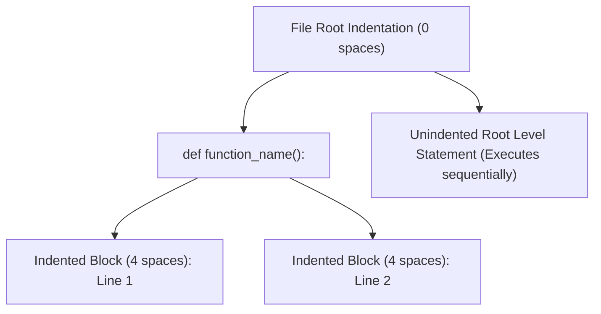
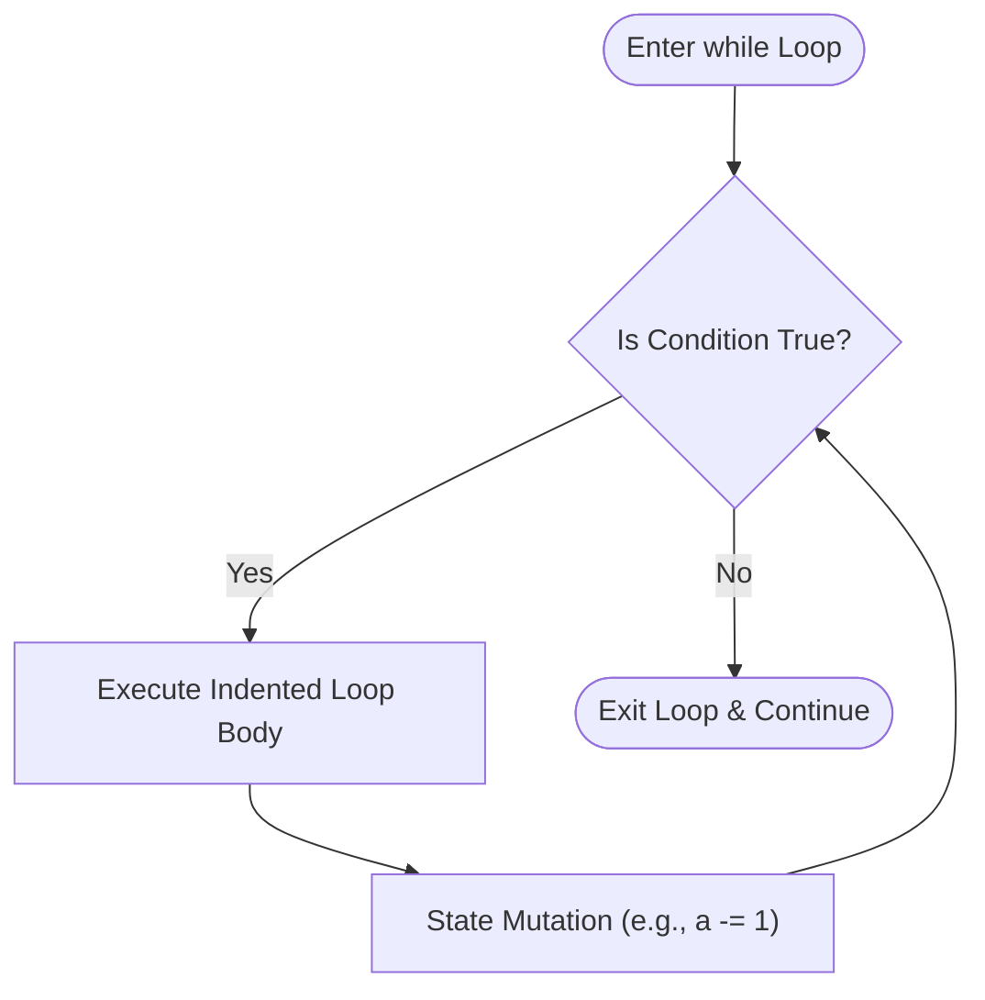
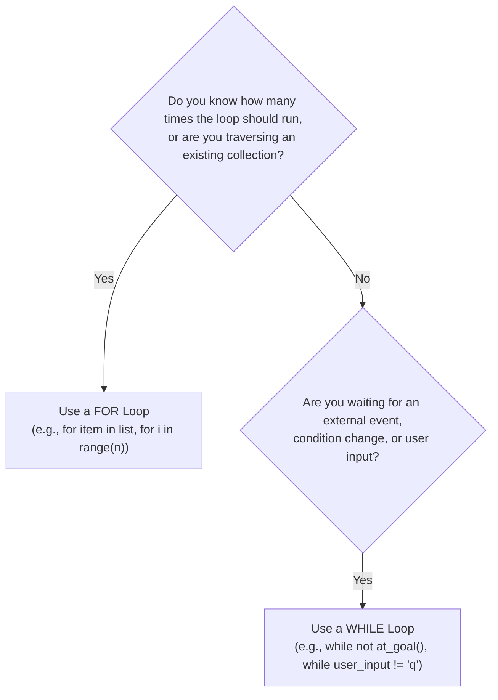
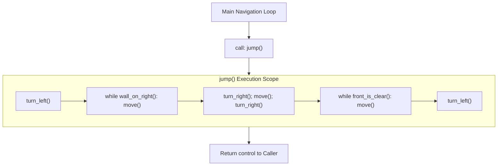
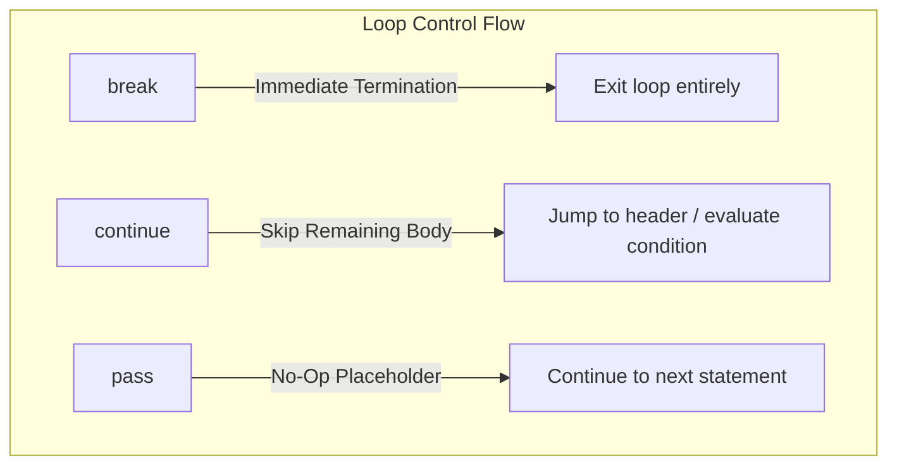
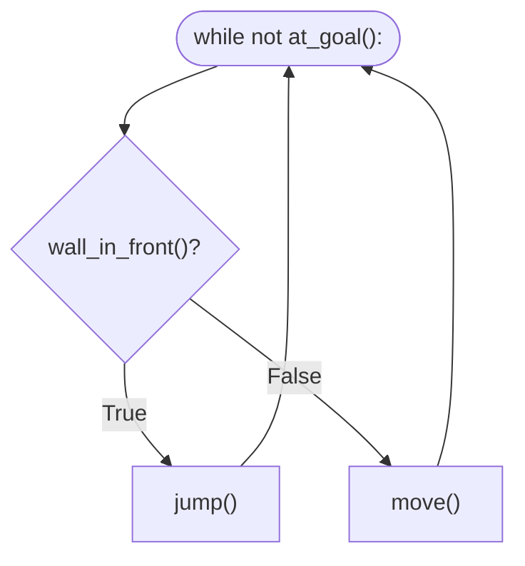

# Python Course Notes: Day 6 — Functions, Code Blocks & While Loops

A comprehensive, structured reference guide covering procedural abstraction, function definitions, modular composition, indentation mechanics, indefinite iteration with `while` loops, structural archetypes (encapsulated, sequential, and nested loops), infinite loop diagnostics, and reactive state-machine navigation (the Hurdle & Maze algorithms).

---

## Table of Contents
1. [Deconstructing Functions: Built-in vs. User-Defined](#1-deconstructing-functions-built-in-vs-user-defined)
   - [What is a Function?](#what-is-a-function)
   - [Built-in Functions vs. Custom Functions](#built-in-functions-vs-custom-functions)
   - [Defining and Calling Functions (`def` Keyword & `()` Syntax)](#defining-and-calling-functions-def-keyword--syntax)
   - [The Return Mechanism (`return` vs. `print`)](#the-return-mechanism-return-vs-print)
2. [Code Blocks, Lexical Scope & Indentation Rules](#2-code-blocks-lexical-scope--indentation-rules)
   - [Indentation as Syntax (PEP 8)](#indentation-as-syntax-pep-8)
   - [Function Scope & Execution Lifecycles](#function-scope--execution-lifecycles)
   - [Modular Composition: Functions Calling Functions](#modular-composition-functions-calling-functions)
3. [Algorithmic Problem Solving via Procedural Abstraction](#3-algorithmic-problem-solving-via-procedural-abstraction)
   - [The Reeborg’s World Robot Paradigm](#the-reeborgs-world-robot-paradigm)
   - [Overcoming Primitive Constraints: Engineering `turn_right()`](#overcoming-primitive-constraints-engineering-turn_right)
   - [Decomposing Compound Behaviors: The `jump()` Procedure](#decomposing-compound-behaviors-the-jump-procedure)
   - [Combining Abstractions with Iteration (`for` + Function)](#combining-abstractions-with-iteration-for--function)
4. [Indefinite Iteration: The `while` Loop](#4-indefinite-iteration-the-while-loop)
   - [Syntax & Evaluation Lifecycle](#syntax--evaluation-lifecycle)
   - [State Mutation & Decrementing Counters](#state-mutation--decrementing-counters)
   - [Dynamic Predicates: Using Functions as Loop Conditions](#dynamic-predicates-using-functions-as-loop-conditions)
5. [The Architectural Divide: `for` Loops vs. `while` Loops](#5-the-architectural-divide-for-loops-vs-while-loops)
   - [Definite vs. Indefinite Iteration](#definite-vs-indefinite-iteration)
   - [Decision Matrix: When to Use `for` vs. `while`](#decision-matrix-when-to-use-for-vs-while)
   - [Truthiness & Idiomatic Boolean Evaluation](#truthiness--idiomatic-boolean-evaluation)
6. [Structural Archetypes: Combining Functions, While Loops & Branching Trees](#6-structural-archetypes-combining-functions-while-loops--branching-trees)
   - [Archetype 1: Encapsulating While Loops inside Functions](#archetype-1-encapsulating-while-loops-inside-functions)
   - [Archetype 2: Sequential While Loops in a Routine (Multi-Phase Pipelines)](#archetype-2-sequential-while-loops-in-a-routine-multi-phase-pipelines)
   - [Archetype 3: Nested While Loops & Multi-Level Indentation](#archetype-3-nested-while-loops--multi-level-indentation)
   - [Archetype 4: Taxonomy of Conditional Branching within While Loops](#archetype-4-taxonomy-of-conditional-branching-within-while-loops)
   - [Refactoring Analysis: Verbose Equality vs. Idiomatic Truthiness](#refactoring-analysis-verbose-equality-vs-idiomatic-truthiness)
7. [The Infinite Loop Hazard & Defensive Programming](#7-the-infinite-loop-hazard--defensive-programming)
   - [Root Causes of Unbounded Loops](#root-causes-of-unbounded-loops)
   - [Diagnostic Techniques: Probe Printing & State Tracing](#diagnostic-techniques-probe-printing--state-tracing)
   - [Defensive Guard Counters (Failsafe Patterns)](#defensive-guard-counters-failsafe-patterns)
   - [Loop Control Statements: `break`, `continue`, and `pass`](#loop-control-statements-break-continue-and-pass)
8. [Case Studies & Progressive Challenge Synthesis](#8-case-studies--progressive-challenge-synthesis)
   - [Hurdle 1: Fixed Distance & Periodic Obstacles (`for` Loop)](#hurdle-1-fixed-distance--periodic-obstacles-for-loop)
   - [Hurdle 2 & 3: Variable Distance & Dynamic Sensing (`while not at_goal()`)](#hurdle-2--3-variable-distance--dynamic-sensing-while-not-at_goal)
   - [Branching Simplification: Eliminating Redundant Checks](#branching-simplification-eliminating-redundant-checks)
   - [Hurdle 4: Variable Heights & Dynamic Wall Scaling](#hurdle-4-variable-heights--dynamic-wall-scaling)
   - [The Maze: Algorithmic Wall-Following (The Right-Hand Rule)](#the-maze-algorithmic-wall-following-the-right-hand-rule)
9. [Quick Reference & Best Practices Summary](#9-quick-reference--best-practices-summary)
   - [Concept vs. Syntax Matrix](#concept-vs-syntax-matrix)
   - [Golden Rules of Day 6](#golden-rules-of-day-6)

---

## 1. Deconstructing Functions: Built-in vs. User-Defined

### What is a Function?
A **function** is a packaged, reusable block of code designed to perform a single, coherent task. Functions form the primary unit of **procedural abstraction** in programming: they allow you to bundle complex instructions behind a clean name, eliminating code duplication and isolating logic into modular components.

```text
Input (Arguments)  ───>  [ Function Logic / Algorithm ]  ───>  Output (Return Value)
```

### Built-in Functions vs. Custom Functions

Python provides a rich catalog of **built-in functions** available globally without requiring imports:
- `print()`, `input()`, `len()`, `range()`, `sum()`, `max()`, `min()`, `int()`, `str()`, `type()`
- Official Reference: [Python Standard Library Built-in Functions](https://docs.python.org/3/library/functions.html)

While built-ins cover universal operations, real-world development requires authoring **user-defined functions** tailored to specific domain problems.

### Defining and Calling Functions (`def` Keyword & `()` Syntax)

Just as lists are syntactically denoted by brackets `[]` and dictionaries by braces `{}`, **functions in Python are defined and called using parentheses `()`**.

```python
# 1. DEFINING a function (Registering instructions in memory)
def say_hello_and_bye():
    # Code block belonging to the function (must be indented)
    print("Hello")
    print("Bye")

# 2. CALLING / INVOKING the function (Executing the registered instructions)
say_hello_and_bye()
```

#### Anatomical Breakdown
1. **`def` Keyword:** Tells the Python interpreter that a function definition begins.
2. **Function Identifier (`say_hello_and_bye`):** The name assigned to the function. Follows PEP 8 `snake_case` naming conventions.
3. **Parameter List `()`:** Specifies what inputs (if any) the function accepts. Empty parentheses `()` signify that no parameters are required.
4. **Colon `:`:** Signals the header's completion and precedes an indented block of statements.
5. **Indented Body:** The sequence of operations executed only when the function is explicitly invoked.

> [!IMPORTANT] Definition vs. Invocation
> Defining a function merely registers its instructions in Python's namespace; **it does not execute them**. To trigger execution, the function must be explicitly called by appending parentheses: `say_hello_and_bye()`. Omitting the parentheses references the function object itself rather than calling it.

### The Return Mechanism (`return` vs. `print`)

A critical conceptual distinction is understanding the difference between **displaying a value** and **returning a value**:

- **`print()`** is an output side-effect: it prints human-readable characters to the console/terminal. The running program cannot capture or perform calculations on printed text.
- **`return`** exits the function immediately and passes data back to the caller. This return value can be assigned to a variable, passed to another function, or used in conditional evaluations.

```python
# A function with a return value:
a = 0

def our_target():
    # Returns a boolean evaluation back to the calling scope:
    return a == 23

# The return value can now be evaluated as a condition:
while not our_target():
    a += 1

print(f"Target reached: a = {a}")  # 23
```

> [!NOTE] Default Return Value
> If a function terminates without an explicit `return` statement, Python implicitly returns `None`.

---

## 2. Code Blocks, Lexical Scope & Indentation Rules

### Indentation as Syntax (PEP 8)

Unlike languages such as C, Java, or JavaScript that use curly braces `{}` to define code blocks, **Python uses indentation depth as a strict syntactical requirement**.



#### PEP 8 Standard Guidelines:
- Use **4 spaces per indentation level**. Never mix tabs and spaces.
- Every statement indented underneath a header ending with a colon `:` belongs to that block.
- When indentation returns to the previous level, that block is closed.

### Function Scope & Execution Lifecycles

Variables created inside a function have **local scope**. They are created when the function is called and destroyed when the function exits:

```python
def calculate_area():
    width = 10    # Local variable
    height = 5    # Local variable
    return width * height

area = calculate_area()
# print(width)  <-- Raises NameError: name 'width' is not defined
```

### Modular Composition: Functions Calling Functions

Functions can call other functions. This principle—**composition**—enables building sophisticated systems out of simple, easily testable building blocks:

```python
def say_hello_and_bye():
    print("Hello")
    print("Bye")

def say_hello_and_bye_twice():
    say_hello_and_bye()  # First invocation
    say_hello_and_bye()  # Second invocation

say_hello_and_bye_twice()
```

**Output:**
```text
Hello
Bye
Hello
Bye
```

---

## 3. Algorithmic Problem Solving via Procedural Abstraction

### The Reeborg’s World Robot Paradigm
In introductory computer science, [Reeborg's World](https://reeborg.ca/) models a robot situated on a discrete 2D grid. The robot provides primitive sensory and movement methods:
- **Primitives**: `move()`, `turn_left()`
- **Sensors (Predicates)**: `front_is_clear()`, `wall_in_front()`, `at_goal()`, `right_is_clear()`

The educational value of Reeborg's World is that **the robot lacks high-level commands** (such as turning right or jumping walls). The developer must engineer these abstractions from scratch.

### Overcoming Primitive Constraints: Engineering `turn_right()`

Because the robot can only turn left ($90^\circ$ counter-clockwise), a $90^\circ$ clockwise right turn is mathematically equivalent to three consecutive left turns:
$$3 \times 90^\circ \text{ Left} = 270^\circ \text{ Left} \equiv 90^\circ \text{ Right}$$

```python
def turn_right():
    turn_left()
    turn_left()
    turn_left()
```

By abstracting these three primitive calls into `turn_right()`, subsequent code can treat turning right as a native operation.

### Decomposing Compound Behaviors: The `jump()` Procedure

To navigate a hurdle of fixed dimensions:
1. Step forward to the barrier.
2. Turn left ($90^\circ$ face up).
3. Ascend past the wall (`move()`).
4. Turn right ($90^\circ$ face forward across wall top).
5. Cross the barrier top (`move()`).
6. Turn right ($90^\circ$ face down).
7. Descend back to ground level (`move()`).
8. Turn left ($90^\circ$ restore default forward orientation).

```python
def jump():
    move()
    turn_left()
    move()
    turn_right()
    move()
    turn_right()
    move()
    turn_left()
```

### Combining Abstractions with Iteration (`for` + Function)

Without iteration, executing 6 hurdle jumps requires writing `jump()` 6 separate times. By combining procedural abstraction with a count-controlled `for` loop, code duplication is completely eliminated:

```python
# Procedural abstraction + Loop execution:
for step in range(6):
    jump()
```

---

## 4. Indefinite Iteration: The `while` Loop

### Syntax & Evaluation Lifecycle

While a `for` loop executes across a predetermined sequence, a **`while` loop continues executing as long as a specified condition remains `True`**.

```text
while <boolean_condition>:
    <statement_1>
    <statement_2>
```



#### Lifecycle Execution Steps:
1. Python evaluates `<boolean_condition>`.
2. If the condition evaluates to `True`, the entire indented body executes from top to bottom.
3. When the end of the body is reached, execution jumps back to the header, re-evaluating the condition.
4. If the condition is `False`, the loop body is bypassed entirely, and control transfers to the next unindented line.

### State Mutation & Decrementing Counters

For a `while` loop to terminate naturally, **something inside the loop body must mutate state** toward a condition that eventually evaluates to `False`:

```python
a = 10

while a > 0:
    print(a)
    a -= 1  # State mutation: decrements 'a' toward the termination threshold (0)

print(f"Done: a = {a}.")
```

**Output:**
```text
10
9
8
7
6
5
4
3
2
1
Done: a = 0.
```

### Dynamic Predicates: Using Functions as Loop Conditions

In robotics and systems programming, loop termination conditions are frequently dynamic sensory readings or boolean function evaluations:

```python
# Function returning a boolean predicate:
def at_goal():
    # Returns True when current coordinates match destination
    return current_position == destination_coordinates

# Idiomatic while loop driven by predicate:
while not at_goal():
    jump()
```

---

## 5. The Architectural Divide: `for` Loops vs. `while` Loops

### Definite vs. Indefinite Iteration

| Dimension | `for` Loop (Definite) | `while` Loop (Indefinite) |
| :--- | :--- | :--- |
| **Execution Horizon** | **Known in advance**: Operates over a bounded collection or fixed `range()`. | **Unpredictable in advance**: Operates until an environmental condition or state changes. |
| **Termination Mechanism**| Automatic: Ends when the underlying iterable is exhausted. | Manual: Relies on in-loop state mutation or an external signal evaluating to `False`. |
| **Iteration Variable** | Automatically bound and updated on each cycle (`for item in items:`). | Must be initialized before the loop and manually mutated inside the body. |
| **Risk of Infinite Loop**| Zero (collections and ranges are finite). | High (if state mutation or exit condition is flawed). |

### Decision Matrix: When to Use `for` vs. `while`



#### Practical Rule of Thumb:
- **Choose `for`**: When iterating over every element of a list, string, dictionary, or when repeating an action an exact, predetermined number of times ($N$).
- **Choose `while`**: When driving an agent toward an unknown destination, polling a network socket, prompting a user until valid input is received, or simulating games where the end condition depends on player choices.

### Truthiness & Idiomatic Boolean Evaluation

In Python, conditions evaluate according to **truthiness**. Explicitly comparing a boolean expression to `True` or `False` is considered anti-idiomatic and redundant.

```python
# POOR / REDUNDANT:
while at_goal() == False:
    jump()

while at_goal() != True:
    jump()

# IDIOMATIC / CLEAN:
while not at_goal():
    jump()
```

| Pattern | Clean / Idiomatic | Redundant / Anti-pattern |
| :--- | :--- | :--- |
| Check if condition holds | `if wall_in_front():` | `if wall_in_front() == True:` |
| Check if condition fails | `if not front_is_clear():` | `if front_is_clear() == False:` |
| Check loop continuation | `while not at_goal():` | `while at_goal() != True:` |

---

## 6. Structural Archetypes: Combining Functions, While Loops & Branching Trees

As software complexity increases, procedural abstractions (`def`), indefinite loops (`while`), and multi-way conditionals (`if`/`elif`/`else`) must be combined into robust architectural patterns.

### Archetype 1: Encapsulating While Loops inside Functions

When a specific procedural task itself requires indefinite iteration until a sub-condition is met, the `while` loop should be encapsulated entirely **inside** a user-defined function.

```python
def climb_to_obstacle_ceiling():
    """Ascends vertically until the obstacle to the right ends."""
    while wall_on_right():
        move()

def descend_to_surface():
    """Descends vertically until the ground surface is struck."""
    while front_is_clear():
        move()
```



#### Architectural Advantages:
1. **Separation of Concerns:** The outer caller does not need to know the height of the wall; `jump()` handles its own internal ascent and descent loops.
2. **Readability:** Replaces a sprawling 20-line block of nested loops with a clean, expressive single-line call: `jump()`.
3. **Reusability:** The encapsulated routine can be invoked across multiple hurdles without rewriting the loop logic.

---

### Archetype 2: Sequential While Loops in a Routine (Multi-Phase Pipelines)

Often, a business process, data pipeline, or robotics routine must progress through distinct, sequential phases. Instead of cramming all conditions into a single convoluted loop, execute **sequential while loops** back-to-back inside a function:

```python
def execute_phased_routine():
    do_initial_setup()
    
    # Phase 1: Ingestion / Ascent
    while phase_one_active():
        process_stage_one()
        
    # Phase 2: Processing / Traversal (Runs ONLY after Phase 1 finishes)
    while phase_two_active():
        process_stage_two()
        
    # Phase 3: Cleanup / Descent
    while phase_three_active():
        process_stage_three()
```

#### Key Execution Rule:
Phase 2 cannot begin until the Phase 1 `while` loop's condition evaluates to `False`. This guarantees strict, deterministic execution order between asynchronous or condition-dependent phases.

---

### Archetype 3: Nested While Loops & Multi-Level Indentation

A **nested while loop** places an inner `while` loop entirely within the body of an outer `while` loop:

```python
while outer_condition():
    prepare_outer_context()
    
    # Inner Loop: runs to completion on EVERY single cycle of the outer loop
    while inner_condition():
        execute_inner_task()
        mutate_inner_state()
        
    mutate_outer_state()
```

#### Indentation & Scope Lifecycle:
1. The outer loop begins if `outer_condition()` is `True`.
2. Execution hits the inner loop. **The inner loop takes complete control** and executes repeatedly until `inner_condition()` becomes `False`.
3. Only after the inner loop completely exits does execution advance to `mutate_outer_state()`.
4. Execution returns to the top of the outer loop, and the entire cycle repeats.

> [!WARNING] The Nested Infinite Loop Trap
> In nested loops, you must verify state mutations for **both** levels. If the inner loop forgets to mutate state toward its exit condition, the program will freeze permanently inside the inner loop, and the outer loop will never advance.

---

### Archetype 4: Taxonomy of Conditional Branching within While Loops

Within a running `while` loop, dynamic decision-making is implemented by nesting conditional branch trees (`if` / `elif` / `else`). The following patterns represent the standard architectural spectrum:

#### Pattern A: Idiomatic Binary Reactive Branch (Cleanest)
Used when the environment presents two mutually exclusive states:
```python
while not at_goal():
    if wall_in_front():
        jump()
    else:
        move()
```

#### Pattern B: Multi-Way Environmental Sensing (Tri-State Decision Tree)
Used when an agent must prioritize between multiple sensory checks on every cycle:
```python
while not at_goal():
    if right_is_clear():
        turn_right()
        move()
    elif front_is_clear():
        move()
    else:
        turn_left()
```

#### Pattern C: Negated Predicate Loop with Tiered Fallbacks
```python
while not system_ready():
    if critical_error_present():
        trigger_failsafe_abort()
        break
    elif resource_loading():
        wait_for_resource()
    else:
        retry_connection()
```

---

### Refactoring Analysis: Verbose Equality vs. Idiomatic Truthiness

Consider the contrast between beginner code and production Python when expressing conditions:

```python
# -------------------------------------------------------------------
# ANTI-PATTERN: Verbose, Redundant Equality Assertions
# -------------------------------------------------------------------
while condition() != True:
    if check_primary() == True:
        do_primary()
    elif check_secondary() == True:
        do_secondary()
    elif check_tertiary() == True:
        do_tertiary()
    else:
        do_fallback()

# -------------------------------------------------------------------
# PRODUCTION REFACTOR: Idiomatic Pythonic Truthiness
# -------------------------------------------------------------------
while not condition():
    if check_primary():
        do_primary()
    elif check_secondary():
        do_secondary()
    elif check_tertiary():
        do_tertiary()
    else:
        do_fallback()
```

#### Why `while not condition():` is Superior:
1. **Direct Boolean Evaluation:** Functions like `check_primary()` already return a boolean (`True` or `False`). Comparing `True == True` merely evaluates to `True`—it performs a redundant comparison step.
2. **PEP 8 Compliance:** Python's official style guide explicitly states: *"Don't compare boolean values to True or False using =="*.
3. **Robust Truthiness:** Writing `if condition:` naturally handles Python's broader truth value testing rules (where empty strings `""`, empty lists `[]`, and `0` evaluate as falsy).

---

## 7. The Infinite Loop Hazard & Defensive Programming

### Root Causes of Unbounded Loops

An **infinite loop** occurs when a `while` loop's condition can never transition to `False`. When this happens, the Python process will consume 100% of a CPU core indefinitely and lock the execution thread.

```python
# COMMON INFINITE LOOP CAUSES:

# 1. Condition is a tautology (always True):
while 5 == 5:
    print("Stuck!")

# 2. Missing state mutation (variable never increments/decrements):
count = 10
while count > 0:
    print(count)
    # FORGOT: count -= 1

# 3. Mutation in wrong direction (moves away from termination bound):
count = 10
while count > 0:
    print(count)
    count += 1  # Moves toward positive infinity; count will never be <= 0!
```

### Diagnostic Techniques: Probe Printing & State Tracing

If your program freezes or hangs during a `while` loop, apply **probe printing** to trace state transitions:

```python
count = 10
while count > 0:
    # Diagnostic probe print:
    print(f"[DEBUG] Loop iteration running. Current count = {count}, Condition evaluates to: {count > 0}")
    count -= 1
```

By observing the output stream, you can immediately identify whether variables are mutating as intended or if the loop condition is stuck.

### Defensive Guard Counters (Failsafe Patterns)

In production software, autonomous agents, and robotics, relying solely on an environmental condition poses safety risks. If sensor readings fail, the system freezes. 

**Best Practice: The Failsafe Guard Counter Pattern:**

```python
max_iterations = 1000  # Defensive hard limit
iterations = 0

while not at_goal():
    jump()
    iterations += 1
    
    if iterations >= max_iterations:
        print("[ERROR] Safety limit reached! Aborting to prevent infinite loop.")
        break
```

### Loop Control Statements: `break`, `continue`, and `pass`

Python provides three control keywords to alter loop execution dynamically:



1. **`break`**: Immediately terminates the innermost loop and resumes execution after the loop block.
   ```python
   while True:
       user_input = input("Enter 'q' to quit: ")
       if user_input.lower() == 'q':
           break
   ```
2. **`continue`**: Aborts the remainder of the *current cycle* and immediately returns to the condition check.
   ```python
   number = 0
   while number < 10:
       number += 1
       if number % 2 == 0:
           continue  # Skip even numbers
       print(number) # Prints only odd numbers: 1, 3, 5, 7, 9
   ```
3. **`pass`**: A syntactical placeholder that does nothing. Used when a code block is syntactically required but no action is needed.

---

## 8. Case Studies & Progressive Challenge Synthesis

The Reeborg’s World hurdle challenges illustrate the transition from static, hardcoded instructions to dynamic, sensor-driven reactive state machines.

### Hurdle 1: Fixed Distance & Periodic Obstacles (`for` Loop)
- **Environment**: Fixed hurdle positions, exactly 6 hurdles, fixed hurdle heights (1 unit).
- **Architecture**: A count-controlled `for` loop executing a pre-packaged `jump()` procedure:

```python
def turn_right():
    turn_left()
    turn_left()
    turn_left()

def jump():
    move()
    turn_left()
    move()
    turn_right()
    move()
    turn_right()
    move()
    turn_left()

for _ in range(6):
    jump()
```

---

### Hurdle 2 & 3: Variable Distance & Dynamic Sensing (`while not at_goal()`)
- **Environment**: Hurdles are placed at unpredictable intervals. The distance between hurdles varies randomly.
- **Problem with `for` loops**: A hardcoded loop count cannot predict how many steps or jumps are required.
- **Solution**: A `while not at_goal():` loop that dynamically chooses whether to walk forward or jump based on sensor inputs.



### Branching Simplification: Eliminating Redundant Checks

Consider the evolution of the decision tree:

```python
# STAGE 1: Explicit, Verbose & Redundant
while not at_goal():
    if front_is_clear() == True:
        move()
    elif wall_in_front() == True:
        jump()

# STAGE 2: Idiomatic Negation
while not at_goal():
    if not wall_in_front():
        move()
    elif not front_is_clear():
        jump()

# STAGE 3: Optimal Binary Branching (Clean & Idiomatic)
while not at_goal():
    if wall_in_front():
        jump()
    else:
        move()
```

> [!TIP] The Binary Optimization Principle
> Because a robot in front of a grid cell faces a strict binary state—either there is a wall in front or the path is clear—checking both conditions with `elif` is redundant. An `if/else` pair models the reality with minimal instruction cycles.

---

### Hurdle 4: Variable Heights & Dynamic Wall Scaling

In Hurdle 4, the walls are not of uniform height ($1$ unit). A wall may be $1$, $2$, $3$, or $4$ units tall.

A hardcoded `jump()` function that moves up only once fails immediately. The jump procedure itself must become **dynamic**, utilizing encapsulated sequential `while` loops (Archetype 1 & 2):

```python
def turn_right():
    turn_left()
    turn_left()
    turn_left()

def dynamic_jump():
    turn_left()
    # Sequential While Loop Phase 1: Ascend dynamically until wall ends
    while wall_on_right():
        move()
    
    # Traverse over the top
    turn_right()
    move()
    turn_right()
    
    # Sequential While Loop Phase 2: Descend dynamically until ground level is struck
    while front_is_clear():
        move()
        
    turn_left()

# Outer Master Loop
while not at_goal():
    if wall_in_front():
        dynamic_jump()
    else:
        move()
```

---

### The Maze: Algorithmic Wall-Following (The Right-Hand Rule)

The ultimate synthesis of Day 6 is navigating an arbitrary, unknown 2D maze to reach the goal.

#### The Right-Hand Rule Algorithm
If you keep your right hand continuously touching a wall in a simply connected maze, you are mathematically guaranteed to find the exit.

```python
def turn_right():
    turn_left()
    turn_left()
    turn_left()

# Edge Case Pre-Condition:
# If the robot starts in an open space without walls, 
# step forward until a wall is found to anchor the right-hand rule:
while front_is_clear() and not at_goal():
    move()
turn_left()

# Core Reactive Navigation Loop:
while not at_goal():
    if right_is_clear():
        turn_right()
        move()
    elif front_is_clear():
        move()
    else:
        turn_left()
```

#### Decision Priority Mechanics:
1. **Priority 1 (Turn Right):** Always explore openings to the right first.
2. **Priority 2 (Move Forward):** If the right is blocked by a wall, move forward along the wall.
3. **Priority 3 (Turn Left):** If both right and front are blocked (a corner or dead-end), pivot left to stay aligned with the perimeter.

---

## 9. Quick Reference & Best Practices Summary

### Concept vs. Syntax Matrix

| Programming Goal | Primary Construct | Code Example |
| :--- | :--- | :--- |
| **Define a custom procedure** | `def <name>():` | `def turn_right():` |
| **Invoke / Execute function** | `<name>()` | `turn_right()` |
| **Return data to caller** | `return <value>` | `return a == 23` |
| **Definite count loop** | `for _ in range(n):` | `for _ in range(6): jump()` |
| **Indefinite goal-seeking loop**| `while <condition>:` | `while not at_goal():` |
| **Sequential phased loops** | `while cond1: ... while cond2: ...` | Phased ascent $\rightarrow$ descent |
| **Nested iteration** | `while outer: while inner: ...` | Matrix or multi-stage polling |
| **Mutate loop state** | Assignment operator (`-=`, `+=`) | `count -= 1` |
| **Exit loop immediately** | `break` | `if done: break` |
| **Skip to next cycle** | `continue` | `if skip: continue` |
| **Syntactic placeholder** | `pass` | `def todo(): pass` |

---

### Golden Rules of Day 6

1. **Parentheses are Compulsory for Invocation**: Defining a function registers it; calling it requires parentheses `func()`. Without parentheses, you pass the function object itself.
2. **Indentation Dictates Block Membership**: Statements aligned at 4 spaces belong to the function or loop body; unindented statements belong to the outer scope.
3. **Encapsulate Repetition Inside Functions**: When a discrete task requires internal iteration (such as dynamic ascent or descending), encapsulate the `while` loop inside a dedicated function to keep the main orchestration loop clean and readable.
4. **Prefer `for` for Sequences, `while` for Goals**: If you know how many times an operation repeats, use `for`. If waiting for a dynamic or unpredictable condition, use `while`.
5. **Always Guarantee Loop Mutation**: Every `while` loop must contain logic that moves state toward the termination threshold, or include a defensive iteration guard limit.
6. **Embrace Implicit Truthiness**: Write clean, Pythonic conditionals (`if wall_in_front():` and `while not at_goal():`) instead of redundant equality checks against `True` or `False`.
